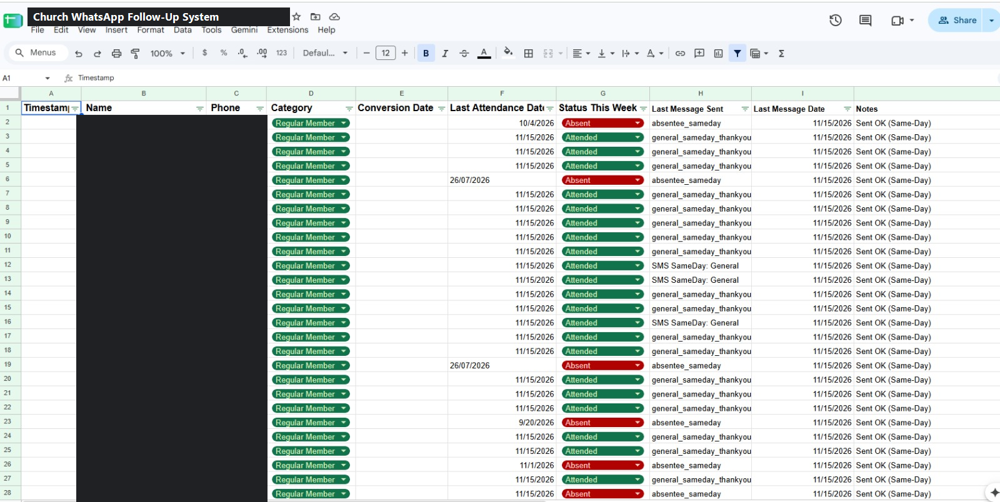
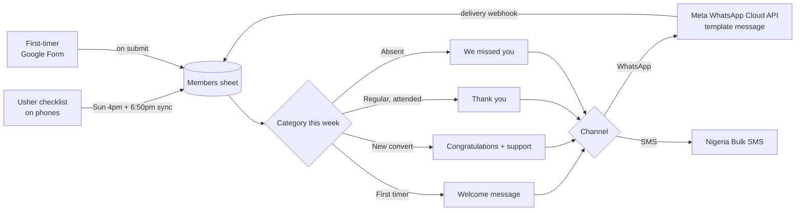

# Church Follow-Up System: WhatsApp + SMS, on Google Sheets & Apps Script

**A follow-up system running for a church in Nigeria. After every Sunday service it sends each person the right message for who they are (first timer, new convert, regular member or absentee) on WhatsApp or SMS, then invites them back on Saturday. No paid CRM: everything runs inside Google Sheets.**

Client name kept private. The code here is the production script, with the church name and settings replaced by placeholders.

[Book a free automation audit](https://calendly.com/eriksammy79/30min) · Built by [AutoMinds AI Services](https://autominds-ai.github.io)

*Members sheet after a Sunday send (names and numbers hidden). Each row records which message went out, when, and whether it was delivered to the provider.*

---

## The problem
Churches lose first timers and new converts when nobody follows up that week. Doing it by hand means:
- someone copying names from attendance sheets every Sunday,
- sending dozens of messages one by one,
- no record of who was contacted, who was absent, or whose number failed.

## What the system does
| When | What happens |
|---|---|
| **Saturday 6 pm** | Refreshes a simple **usher checklist** (a separate sheet with only name, phone and status) so ushers never touch the main database |
| **Sunday, during service** | Ushers mark attendance and add new first timers and new converts on their phones. First timers can also fill a **Google Form**, which adds them automatically |
| **Sunday 4 pm and 6:50 pm** | Syncs the checklist into the Members database: updates attendance, adds new people, marks new converts. The second pass catches late entries |
| **Sunday 7 pm** | **Same-day follow-up**: a personal message for each category: welcome (first timer), congratulations and support (new convert), thank you (regular), "we missed you" (absentee) |
| **Saturday 9 am** | **Reminder** inviting everyone to the next service, with the service time |

Each member has a **channel**: WhatsApp (approved Meta templates) or SMS (Nigeria Bulk SMS). The system picks the right one per person.

## Engineering details
| Feature | How it works |
|---|---|
| **New convert "graduation"** | New converts get new-convert messages for a set number of weeks (`NEW_CONVERT_WEEKS`, default 8), then move to Regular Member automatically |
| **Delivery tracking** | The script is deployed as a web app that receives Meta's webhook and writes *sent / delivered / read* against each message ID |
| **Credentials out of the code** | Access token, phone-number ID, SMS login and sender ID live in a `Config` tab, never in the script |
| **Phone normalisation** | Any format (`080…`, `+234…`, `80…`) is converted to international format before sending |
| **Safe testing** | Send to a single row, or to a small trusted group of rows, before a full run |
| **Data hygiene tools** | Duplicate finder (same phone / same name), blank "ghost" row clean-up, safe insert after the last real member |
| **Reporting** | Results by category and failures grouped by error message, so bad numbers are easy to fix |
| **Pre-flight check** | `healthCheckBeforeTriggers()` confirms every scheduled function exists before triggers are installed |
| **Extras** | Special programme announcements to everyone, and an SMS-only send for when WhatsApp is unavailable |

## Tools
`Google Apps Script` · `Google Sheets` · `Google Forms` · `WhatsApp Cloud API (Meta)` · `Nigeria Bulk SMS API`

## Set it up
1. Create a Google Sheet with tabs **Members**, **Config** and **Form Responses**. The column layout is documented at the top of [`src/Code.gs`](src/Code.gs).
2. **Extensions → Apps Script**, paste `src/Code.gs`, and replace `[Church Name]` in the message texts.
3. Fill the **Config** tab: WhatsApp phone-number ID and token, template names, SMS login and sender ID, service time, and the usher checklist sheet ID.
4. Create and get approval for the WhatsApp templates listed in the file header.
5. Run `healthCheckBeforeTriggers()`, then `setupTriggers()` once.
6. Optional: **Deploy → Web app** and point Meta's webhook at it for delivery tracking.

## Want this for your organisation?
The same engine powers patient follow-up and appointment reminders for clinics, and enquiry follow-up for real estate teams.
**[Book a free 30-minute automation audit →](https://calendly.com/eriksammy79/30min)**

---
MIT License.
